# gcode2krl – slicer dla robota 6-osiowego i translator G-code → KUKA KRL

Narzędzie prowadzi od modelu do programu robota w dwóch krokach:

1. **Slicer** (własny, MIT): model STEP/STL/OBJ → ścieżka drukowania z
   warstwami płaskimi, stożkowymi (RotBot), konforemnymi do powierzchni albo
   wielokierunkowymi, z osią narzędzia I J K przy każdym punkcie.
2. **Translator**: ścieżka (ze slicera albo gotowy G-code z innego slicera /
   CAM) → program KRL dla KUKA KRC4 (KSS 8.x). Ciągi krótkich G1 są z powrotem
   rozpoznawane jako łuki (`SCIRC`/`CIRC`), reszta trafia do `SLIN`/`LIN`,
   fragmenty o zmiennej krzywiźnie i zmiennej orientacji do `SPL`; po drodze
   sprawdzany jest zasięg, limity osi i kolizje robota.

```
STEP/STL ──slicer──> ścieżka (G-code + I J K) ──parser──> ruchy ──łuki / orientacja──> SLIN / SCIRC / SPL ──writer──> PROG.src + PROG.dat
                       gotowy G-code (.nc) ───┘
```

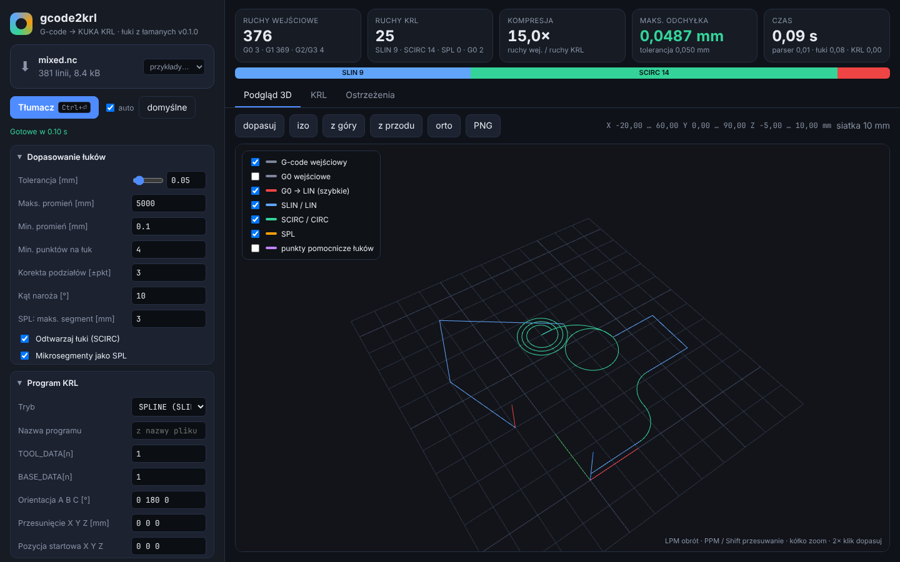

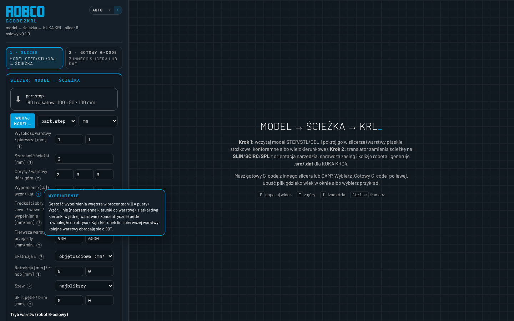

## Instalacja

```bash
pip install -e .          # wymaga Python >= 3.10 i numpy
pip install -e .[test]    # dodatkowo pytest
pip install -e .[step]    # import STEP/IGES (OpenCASCADE)
pytest                    # 163 testy
```

## GUI

Bez instalacji: otwórz `docs/demo.html` w przeglądarce (statyczny podgląd z
gotowymi wynikami dla trzech przykładów; opcje nie przeliczają). Pełna wersja:

```bash
gcode2krl-gui                       # http://127.0.0.1:8765, otwiera przeglądarkę
gcode2krl-gui --port 9000 --no-browser
```

Lokalna aplikacja webowa bez żadnych zależności poza biblioteką standardową
Pythona i numpy (działa offline, np. na komputerze przy robocie):

Praca idzie jak w każdym slicerze — cztery zakładki u góry okna:

* **1 · Przygotowanie** (pierwsze uruchomienie zaczyna tutaj): stanowisko —
  model robota, pozycja HOME, narzędzie (TCP X Y Z, montaż dyszy A B C, model
  STEP), stół do druku (`$BASE` w narożniku blatu, także z 3 punktów; wymiary,
  grubość materiału), strefy bezpieczeństwa, przeszkody, modele stołu i
  uchwytów; wszystko można przeciągać uchwytami w 3D; ustawienia zostają w
  przeglądarce,
* **2 · Model**: upuść model STEP/STL/OBJ (albo „Wgraj model…”) — staje od
  razu na środku stołu i jest rysowany w 3D; ułóż go: przeciągnij uchwyt nad
  modelem albo wpisz X Y, obroty X Y Z, lustro X/Y/Z, skalę, „ułóż płasko” /
  „min. nawisy” (automatyczna orientacja); kilka modeli = kilka kart „Modele
  na stole” („rozmieść” ustawia je obok siebie). Niżej wszystkie parametry
  slicera (każdy z „?”) i przycisk „Pokrój → symulacja”; zakładka *Gotowy
  G-code* przyjmuje plik z innego slicera / CAM,
* **3 · Cięcie**: symulacja pokrojonej i przetłumaczonej ścieżki — suwak
  **warstwa** odsłania ścieżkę do wybranej wysokości (jak podgląd warstw w
  slicerze), **▶** odtwarza ruch robota po ścieżce, a ścieżka nad dyszą jest
  wtedy ukryta (postęp druku); podsumowanie krojenia (warstwy, czas,
  materiał, nawisy), zasięgu i kolizji w panelu bocznym, zakładki *Kolizje*
  i *Ostrzeżenia* nad widokiem, sekcja „Kontrola robota” (orientacja,
  próbkowanie, prześwit, wydruk),
* **4 · Kod**: program KRL z podświetlaniem, pobieranie `.src`/`.dat`, oraz
  jego opcje: łuki, program (TOOL/BASE, A B C, własne linie), prędkości,
  ekstruder, M-kody z CAM; wynik liczy się automatycznie po każdej zmianie.
  Każda opcja, którą czyta serwer (translator, writer KRL, raport robota,
  slicer), ma pole w GUI z przyciskiem „?”; w plikach zostają tylko dane modeli
  robotów (JSON z oficjalnych danych KUKA) i wgrane siatki,

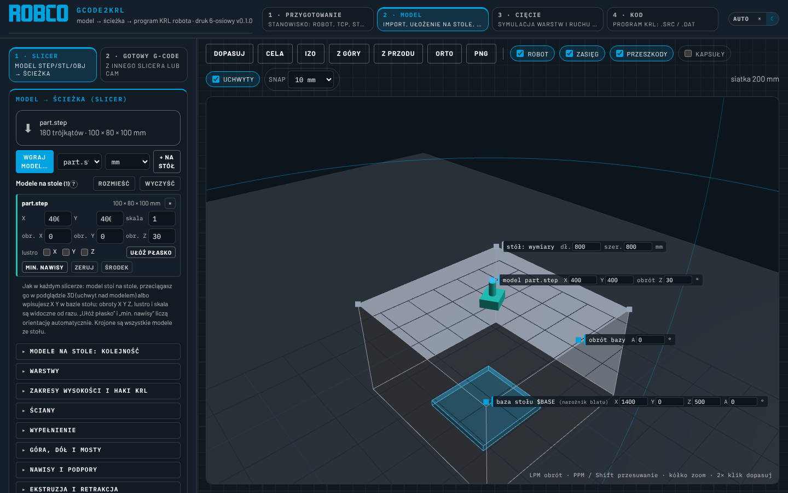

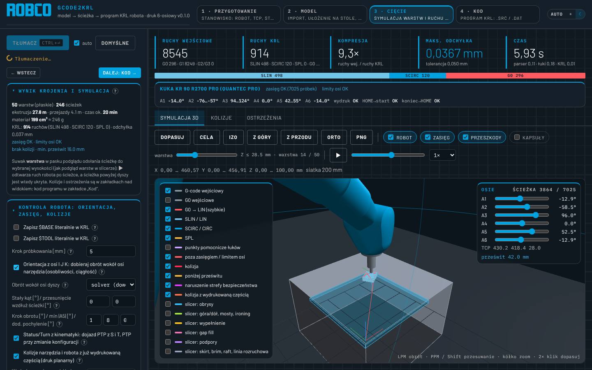

* kafelki: ruchy wejściowe / KRL, kompresja, maksymalna odchyłka (zielona,
  gdy mieści się w tolerancji), czasy parsera / dopasowania / generowania,
* **podgląd 3D** na własnym rendererze WebGL: warstwy G-code wejściowy, G0,
  SLIN, SCIRC, SPL i punkty pomocnicze łuków; obrót (LPM), przesuwanie
  (PPM / Shift), zoom (kółko, pinch), widoki izo / z góry / z przodu,
  rzut ortogonalny, siatka z automatycznym krokiem, eksport PNG;
  skróty `F` dopasuj, `T` z góry, `I` izo, `Ctrl+Enter` tłumacz,
* zakładka **KRL** z podświetlaniem składni, wyborem pliku (program główny i
  podprogramy), kopiowaniem, pobraniem pojedynczego pliku lub `.zip`
  z kompletem `.src` + `.dat` (CRLF),
* zakładka **Ostrzeżenia** z komunikatami parsera (G28, G92, G41/G42,
  niezgodne promienie łuków, brak F…),
* opcje zapamiętywane w przeglądarce (`localStorage`),
* motyw ciemny (domyślny), jasny lub jak system (przełącznik w nagłówku);
  wszystkie kolory, fonty i promienie są tokenami CSS na początku
  `web/style.css`, a `web/brand.css` nakłada identyfikację Robco: paletę
  (granat `#101820`, panele `#151f29`, akcent `#00a3e0`, tekst `#f0eee9`),
  fonty Barlow i IBM Plex Mono (`web/fonts/`, licencja OFL), przyciski
  wielkimi literami z obrysem i poświatą, kafelki z niebieską krawędzią,
  chipy, teksturę siatki i logo (`web/brand/`), zdjęte z www.robco.technology.

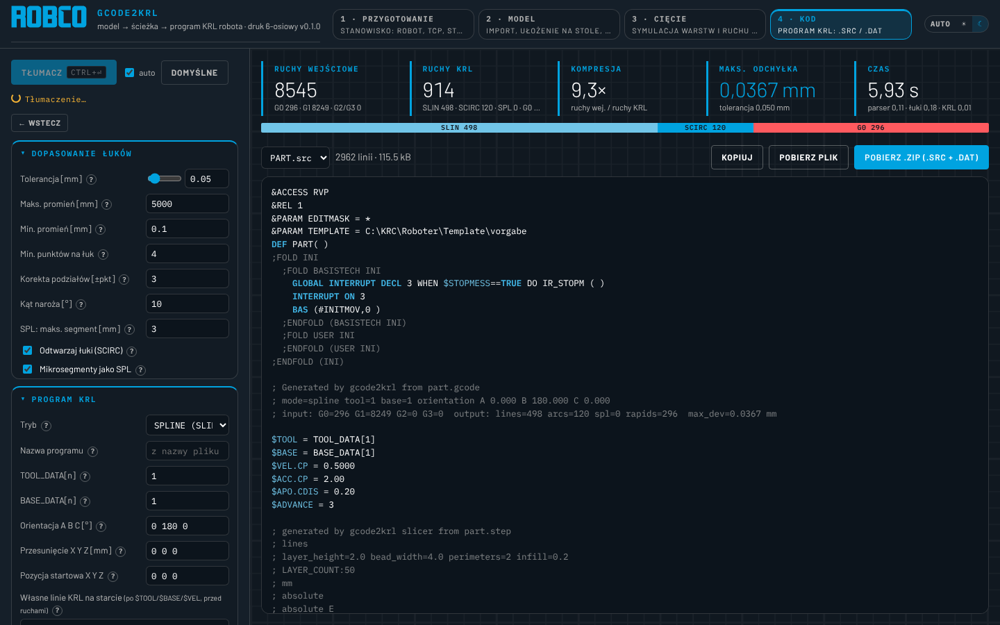

API JSON serwera (do własnej automatyzacji):

| metoda | ścieżka | opis |
|---|---|---|
| GET | `/api/examples`, `/api/example/<nazwa>` | przykładowe pliki |
| GET | `/api/robots` | modele robotów (wymiary, limity, prędkości) |
| POST | `/api/translate` | `{gcode, filename, options}` → statystyki, ostrzeżenia, pliki, geometria podglądu (float32 w base64), raport robota ze śladem osi |
| GET | `/api/zip/<token>` | zip z plikami ostatniego tłumaczenia |

## Slicer (model → G-code dla ekstrudera na robocie)

Własny slicer na licencji MIT, bez kodu z rodziny Slic3r/PrusaSlicer/Bambu/Orca
(AGPL). Operacje na wielokątach wykonuje Shapely (BSD-3; GEOS na LGPL przez
dynamiczne linkowanie), więc licencja projektu pozostaje MIT.

```bash
pip install -e .[slicer]
gcode2krl-slice czesc.step -o czesc.gcode --layer-height 2 --bead-width 4 --perimeters 2 --infill-density 0.2 --speed-outer 20
gcode2krl czesc.gcode -o out/ --extruder-out 7 --extruder-reverse-out 8 --extruder-on-delay -0.1 --extruder-anout 2 --extruder-flow-full 60 \
          --robot KR90R2700PRO --base-frame 1400 0 500 0 0 0
```

Co robi (zestaw funkcji wzorowany na PrusaSlicer / OrcaSlicer / Cura; każdy
parametr jest w GUI, w sekcji *Slicer*, z przyciskiem „?”):

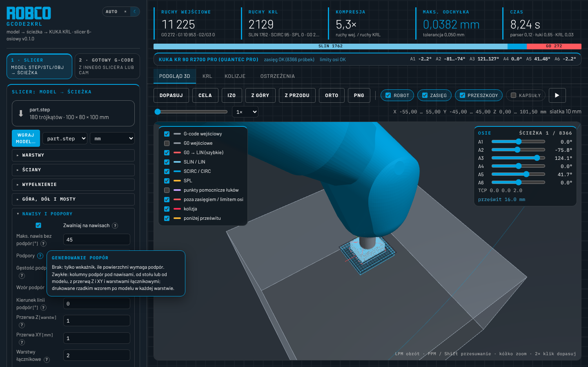

* **cięcie siatki** (STL/OBJ/STEP/IGES) płaszczyznami warstw na zamknięte
  kontury; segmenty łączone z tolerancją, otwarte łańcuchy raportowane;
  **warstwy adaptacyjne** (wysokość z nachylenia powierzchni, reguła schodka
  jak w PrusaSlicer, zakres min–maks),
* **wielokąty warstwy** z zagnieżdżeniem parzystym (otwory), **kompensacja XY
  i otworów**, **stopa słonia** na pierwszej warstwie, usuwanie cech cieńszych
  niż `min_feature`,
* **ściany**: liczba obrysów, osobne szerokości obrysu zewnętrznego /
  wewnętrznych / wypełnienia / warstw pełnych, kolejność wewnętrzne→zewnętrzny
  lub odwrotnie, szew najbliższy / wyrównany / z tyłu / losowy, wolniejsze małe
  obrysy, **gap fill** (szczeliny między obrysami i cienkie ściany pojedynczą,
  zwężoną ścieżką), **tryb spiralny** (wazon: jedna helisa bez szwu),
* **wypełnienie**: linie, zygzak (połączone), siatka, trójkąty, sześcienne
  (przesuwane z Z), gyroid (przybliżenie falami), plaster miodu, koncentryczne;
  zakładka na obrys, łączenie wypełnienia co N warstw (N× wydatek), małe
  obszary jako pełne; linie zakotwiczone w układzie świata, więc warstwy się
  nakładają,
* **góra / dół**: liczba warstw pełnych, wykrywanie z pokrycia przez sąsiednie
  warstwy, wzory linie / zygzak / monotoniczny / koncentryczne,
* **mosty**: obszar nad pustką zakotwiczony z obu stron dostaje proste linie w
  kierunku kotwic, własną prędkość i wydatek,
* **nawisy**: każdy odcinek obrysu i skinu ma stopień „nad pustką” z odległości
  od warstwy niżej (plus podpory); prędkość interpolowana do prędkości nawisów;
  wskaźnik powierzchni wymagającej podpór,
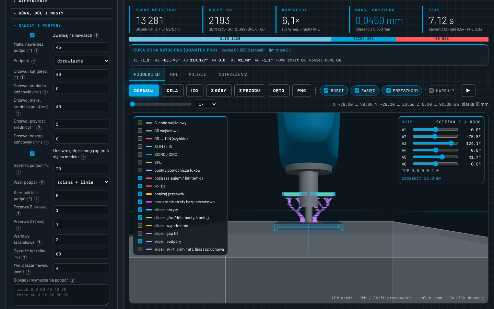

* **podpory** z automatycznym wykrywaniem miejsc (obszary warstwy, których
  warstwa niżej nie niesie w granicach kąta nawisu): **kolumnowe** rzutowane w
  dół do stołu lub modelu oraz **drzewiaste** (`tree_support.py`): końcówki
  gałęzi na siatce heksagonalnej każdej wysepki nawisu, gałęzie schodzą
  warstwa po warstwie z ruchem w bok ≤ h·tg(kąta gałęzi) w stronę sąsiadów i od
  modelu, łączą się w pnie (zachowanie pola), rosną z wysokością do średnicy
  pnia, trzymają odstęp XY, mogą opierać się na modelu; przerwa Z, warstwy
  łącznikowe, wzór linie / siatka / ściana + linie, blokady i wymuszenia
  pudełkami, minimalny obszar wysepki,
* **przyczepność**: skirt, brim, **raft** (podstawa rzadka, warstwy pośrednie,
  górna pełna, model przesunięty w górę),
* **materiał**: mm³ na odcinek (albo sama geometria), mnożnik wydatku,
  wydatek pierwszej warstwy, **wydajność ekstrudera** mm³/s (obcina prędkość),
  gęstość materiału → szacunek masy; **cofnięcie** ekstrudera w mm³ z
  dodatkowym dopuszczeniem, minimalnym przejazdem, przy zmianie warstwy,
  **podniesienie na przejeździe**, **wipe** (cofanie po ścieżce), **coasting**
  (koniec obrysu z wyłączonym ekstruderem),
* **prędkości TCP w mm/s** per funkcja (obrys zewn./wewn., wypełnienie,
  góra/dół, mosty, nawisy, szczeliny, podpory, małe obrysy, pierwsza warstwa,
  przejazdy), **minimalny czas warstwy** z dolną granicą prędkości,
* **kolejność**: skirt/brim → raft → wyspa po wyspie (obrysy → gap → mosty →
  skin → wypełnienie) → podpory, najbliższy sąsiad w każdym bloku,
* **G-code** z `;LAYER_COUNT`, `;LAYER`, `;Z`, `;HEIGHT`, `;TYPE` (WALL-OUTER,
  WALL-INNER, GAP, SKIN, BRIDGE, FILL, SUPPORT, SUPPORT-INTERFACE, RAFT, SKIRT,
  BRIM), zmiany F wewnątrz ścieżki, G0 na przejazdach, E bezwzględne, G-code
  startowy / końcowy; statystyki: długości i czasy per typ, materiał (cm³, g),
  mosty, długość nawisów, objętość podpór, spowolnione warstwy.

* **model i stół**: obrót X/Y/Z, skala, lustro; **automatyczna orientacja**
  (ułóż płasko / minimalne nawisy — kandydaci ze ścianek otoczki, ocena po
  powierzchni nawisów, styku ze stołem i wysokości); **kilka modeli na stole**
  z własnym położeniem, obrotem Z i skalą, drukowane warstwa po warstwie albo
  obiekt po obiekcie,
* **zakresy wysokości**: nadpisania parametrów (wysokość warstwy, prędkości,
  wypełnienie, obrysy, szerokości, pochylenia…) w przedziałach Z,
* **haki KRL na warstwach**: `layer N:`, `z Z:`, `every N:` z dowolną linią
  KRL (HALT na wymianę materiału, WAIT FOR $IN, wyjścia) oraz czekanie między
  warstwami (WAIT SEC — wiązanie betonu / stygnięcie); linie wędrują przez
  G-code jako `;KRL:` i trafiają do programu dosłownie,
* **fuzzy skin** (chropowata ściana), **ironing** (prasowanie wierzchu),
  **linia rozruchowa**, **skirt na N warstwach** (osłona), szew w
  **najostrzejszym narożniku**, kolejność **najpierw wypełnienie**,
  **blokady i wymuszenia podpór** (pudełka),
* **podgląd ścieżek slicera per typ** w widoku 3D (obrysy, góra/dół, mosty,
  ironing, wypełnienie, gap fill, podpory, skirt/brim/raft/linia rozruchowa)
  niezależnie od ścieżki KRL.

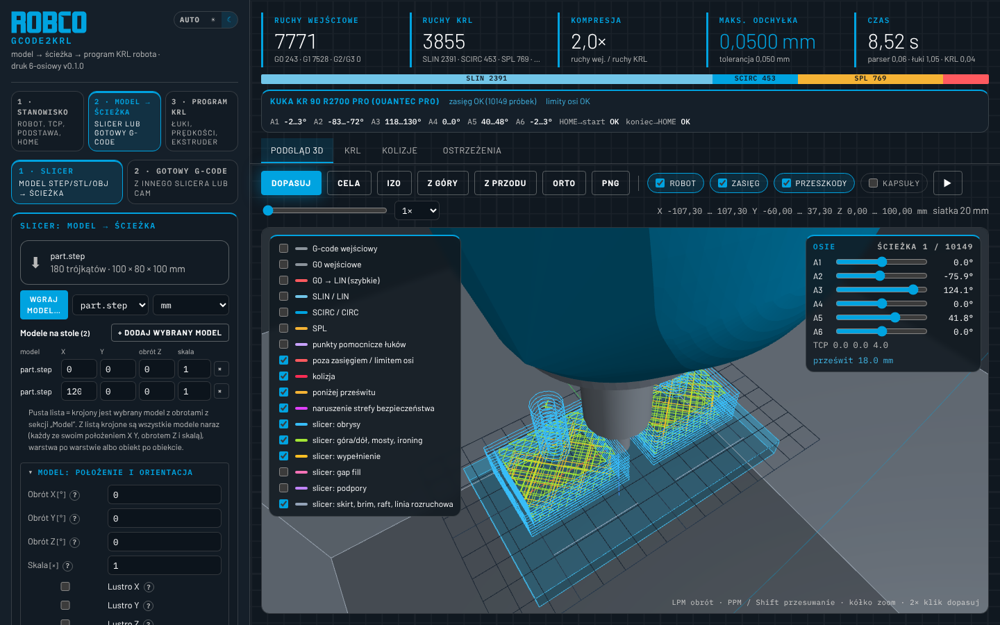

Czego nie ma: Arachne (zmienna szerokość ścian wyliczana z osi medialnej —
cienkie ściany są obsługiwane przez gap fill o stałej szerokości), omijania
obrysów przy przejazdach, wygładzania wydatku (pressure advance jest po
stronie sterownika ekstrudera).
Podpory, raft, spirala i warstwy adaptacyjne działają tylko dla warstw
płaskich; tryby stożkowe i konforemne mają nawisy, gap fill, mosty i wszystkie
pozostałe funkcje liczone w przestrzeni warstw.

### Stricte pod robota: jednostki, ekstruder, program

Slicer i translator nie udają drukarki FDM. Parametry są w jednostkach robota
i ekstrudera przemysłowego, a sterowanie materiałem jest natywne dla KRL:

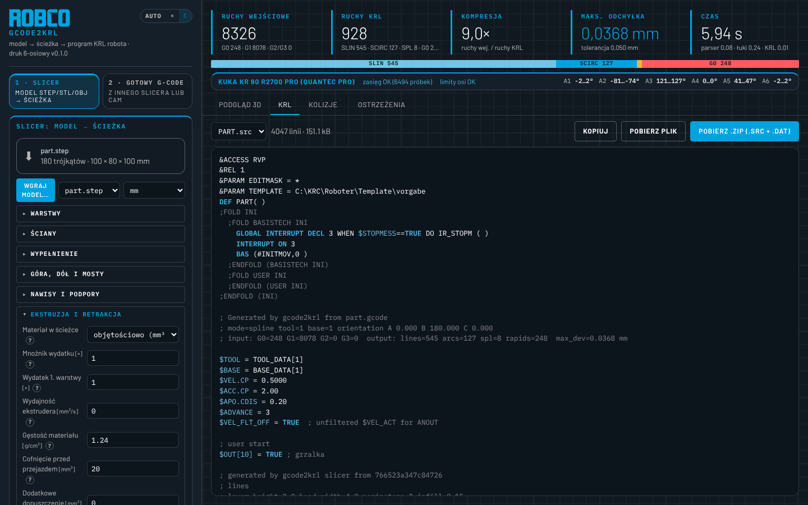

* **prędkości w mm/s** (prędkość TCP), w KRL `$VEL.CP` w m/s; przejazdy jako
  `LIN` z własną prędkością; **ilość materiału w mm³** na odcinek (szerokość ×
  wysokość × długość), bez filamentu i bez M-kodów drukarkowych,
* **włączanie ekstrudera przez TRIGGER**: `TRIGGER WHEN DISTANCE=0 DELAY=t DO
  $OUT[n]=TRUE PRIO=-1` przed blokiem SPLINE (start ścieżki) i `TRIGGER WHEN
  PATH=0 DELAY=t DO $OUT[n]=FALSE PRIO=-1` (koniec bloku) — sterownik wykonuje
  je w locie, bez zatrzymania wyprzedzania, więc ruch zostaje ciągły;
  opóźnienia włączenia/wyłączenia w ms kompensują rozruch i dobieg ślimaka
  (opcja: zwykłe `$OUT` z zatrzymaniem),
* **wydatek analogowo ∝ prędkości TCP**: `ANOUT ON $ANOUT[n] = k * $VEL_ACT`
  z `$VEL_FLT_OFF`, k z mm³/mm ścieżki i wydajności ekstrudera przy 1.0; sygnał
  jest włączany raz i bramkowany wyjściem cyfrowym na przejazdach (bez bramki:
  `ANOUT OFF/ON` wokół przejazdów), zmiana wydatku (mosty, łączone warstwy,
  inna wysokość) = nowa linia `ANOUT ON`,
* **cofnięcie i dopuszczenie** ze slicera (mm³) to w KRL impuls na wyjściu
  rewersu (`$OUT[r]=TRUE`, `WAIT SEC t`, `$OUT[r]=FALSE`, t = mm³ / wydajność)
  oraz `WAIT SEC` z włączonym ekstruderem przed startem ścieżki,
* **wydajność ekstrudera** (mm³/s) obcina prędkość TCP każdej ścieżki,
  **minimalny czas warstwy** i **spowolnienie na nawisach** działają na
  prędkości TCP, więc z wydatkiem analogowym szerokość ścieżki zostaje stała,
* **własne linie KRL** na starcie (po `$TOOL/$BASE/$VEL`, np. `WAIT FOR
  $IN[k]` gotowości ekstrudera, grzałki) i na końcu (przed `END`) — z GUI,
* G-code pozostaje tylko formatem przekazania i eksportu ścieżki (F w mm/min,
  E objętościowe, I J K osi narzędzia); import G-code z CAM zachowuje obsługę
  wrzeciona, chłodziwa i M-kodów w osobnej, zwiniętej sekcji.

### Status i Turn: konfiguracja robota bez osobliwości

Każdy przejazd dostaje z kinematyki odwrotnej **Status** (bit 0: nadgarstek za
osią A1, bit 1: A3 ≥ kąt wyprostowanego ramienia = atan(a₃/d₄) ≈ −2° dla KR 90,
bit 2: A5 < 0) i **Turn** (bit i = oś A(i+1) ujemna) — definicja KUKA, ten sam
podział konfiguracji, który stosuje smartPAD. Pierwszy dojazd do ścieżki to
`PTP {X … C …, S s, T t}` (po `PTP XHOME`), więc sterownik startuje dokładnie w
zaplanowanej konfiguracji; ruchy CP (SLIN/SCIRC/SPL/LIN) trzymają ją dalej.
Przejazdy, na których Status się zmienia (np. łokieć), stają się PTP z nowym
S/T; zmiana samego Turn nie wymaga PTP. Zmiana Statusu **wewnątrz** ścieżki
ciągłej (czyli przejście przez osobliwość) jest wykrywana (pas robota, pole
„configuration”, ostrzeżenie) — wtedy trzeba podnieść min |A5| solvera,
zmienić tryb obrotu albo narzędzie. CLI: `--no-status-turn`.

### Strefy bezpieczeństwa

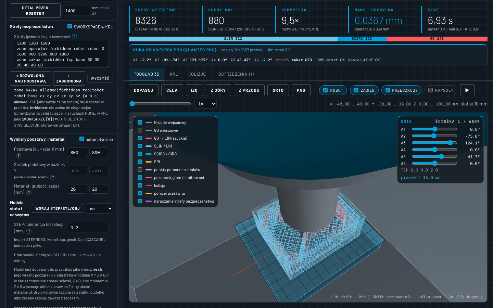

W kroku 1 GUI (pole *Strefy bezpieczeństwa*, CLI `--zones plik`) definiuje
się pudełka, jedna linia na strefę:

```
zone NAZWA allowed|forbidden tcp|robot robot|base  cx cy cz  sx sy sz  [a b c]
zone druk allowed tcp base 0 0 650 1200 1200 1500      # TCP ma zostać nad podstawą
zone operator forbidden robot robot 0 1600 900 1200 800 1800   # żaden człon nie wchodzi
```

* **allowed** — punkt roboczy (`tcp`) albo wszystkie człony robota (`robot`,
  kapsuły z promieniem) muszą zostać w pudełku; **forbidden** — nie wolno do
  niego wejść. Środek, wymiary i obrót A B C w układzie robota lub bazy.
* Sprawdzane na każdej próbce ścieżki oraz na ruchach PTP HOME (interpolacja
  w osiach); naruszenia są liczone per strefa, zaznaczane w podglądzie 3D
  (fiolet), wypisane w pasku robota i w ostrzeżeniach, a CLI zwraca kod 3.
  Przyciski „+ dozwolona nad podstawą” i „+ zabroniona” wstawiają szablony z
  wymiarów podstawy.
* **KRL**: strefy trafiają do programu jako przestrzenie robocze KSS
  `$WORKSPACE[1..8] = {BASE {…}, X1…Z2, MODE #OUTSIDE_STOP|#INSIDE_STOP,
  STATE FALSE}` — sterownik zatrzymuje robota, gdy TCP wyjdzie ze strefy
  dozwolonej albo wejdzie do zabronionej (KSS pilnuje tylko TCP; zakres
  `robot` zapewnia raport aplikacji). Opcja „$WORKSPACE w KRL” / `--no-zones-krl`.

### Uchwyty w widoku 3D: przeciąganie stołu, bazy, TCP, stref, modeli

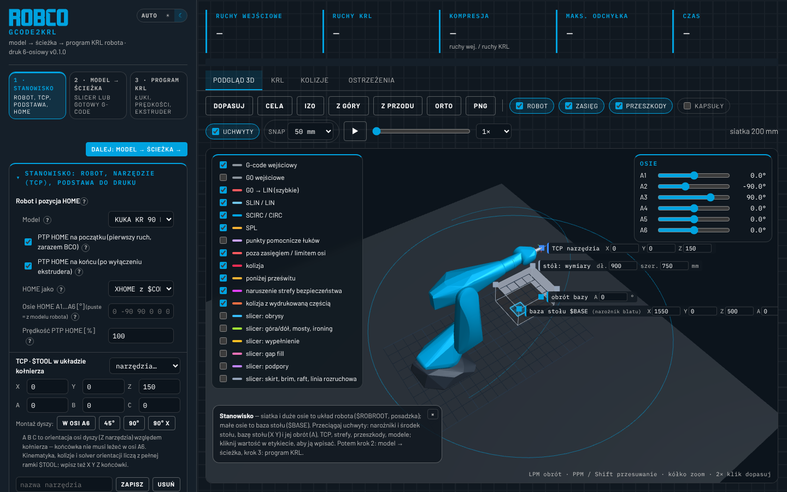

Widok 3D pokazuje stanowisko (robot w HOME, stół, strefy, przeszkody) od
razu po starcie, jeszcze bez ścieżki; przełącznik *uchwyty* w pasku
podglądu włącza punkty z etykietami (nazwa i bieżąca wartość: „stół:
wymiary 900 × 750 mm”, „baza stołu $BASE (narożnik blatu) X 1400 Y 0 Z 500 A 0”,
„TCP narzędzia X Y Z”…), które można chwycić myszą i przeciągnąć; bryła stołu, strefy i
przeszkody przerysowują się w trakcie ruchu z pól formularza, a po puszczeniu
przelicza się program. Każda etykieta ma pola edycyjne (klik → wpisz → Enter),
stół jest rysowany jako pełna bryła od blatu do posadzki robota, a widok
wyświetla scenę w układzie robota: siatka i duże osie to $ROBROOT na
posadzce, małe osie to $BASE (dane ścieżki pozostają w bazie; viewer nakłada
transformację sceny, obrót bazy obraca stół, nie robota):

* **baza stołu** — początek `$BASE` leży **zawsze w narożniku blatu**, tak że
  +X i +Y bazy są skierowane na stół (blat zajmuje 0…długość × 0…szerokość w
  bazie); robot stoi nieruchomo w swoim układzie (0 0 0), uchwyt w narożniku
  przesuwa `$BASE` X Y, a stół jedzie razem z bazą; **uchwyt nad początkiem
  bazy** zmienia Z (wysokość stołu: bryła stołu sięga od blatu do posadzki
  robota, więc rośnie i maleje z Z bazy); **uchwyt na okręgu** — obrót bazy
  A; jedna etykieta „baza stołu $BASE (narożnik blatu) X Y Z A” z
  polami do kliknięcia i wpisania,
* **narożniki blatu** — pozostałe trzy narożniki zmieniają tylko wymiary
  stołu mierzone od bazy (narożnik bazy stoi w miejscu); środek blatu w bazie
  (długość/2, szerokość/2) formularz liczy z wymiarów i tam slicer stawia
  pokrojony model („ustaw model na środku stołu”; plater podaje pozycje w
  bazie); obrys stołu rysuje się na żywo,
* zmiana zakładki zatrzymuje odtwarzanie symulacji,
* **snap** (pasek podglądu: 1/5/10/50/100 mm, Alt wyłącza chwilowo) — pozycje
  i wymiary przyciągane do siatki, obrót bazy co 5°, TCP co najwyżej co 5 mm,
* **TCP** — X Y Z narzędzia względem kołnierza (ruch w płaszczyźnie ekranu);
  przy TCP rysowane są osie narzędzia: **koniec osi dyszy** (Z narzędzia)
  pochyla narzędzie — nowe A B C `$TOOL` liczone z kierunku osi przy
  zachowanym X narzędzia, **koniec osi X** obraca narzędzie wokół dyszy;
  etykieta TCP ma pola X Y Z A B C do wpisania, kąty przyciągane co 5°,
* **strefy bezpieczeństwa** — środek i narożnik (wymiary XY), **przeszkody
  `box`** — środek, **modele na stole** — położenie XY.

Picking liczy odległość rzutu uchwytu od kursora (≤ 14 px), ruch jest
rzutowany na płaszczyznę XY bazy (dla TCP na płaszczyznę ekranu) promieniem
kamery (`viewer.project`, `viewer.ray`); orbita i przesuwanie kamery działają
jak dotąd poza uchwytami.

### Model narzędzia (STEP) i druk planarny bez kolizji

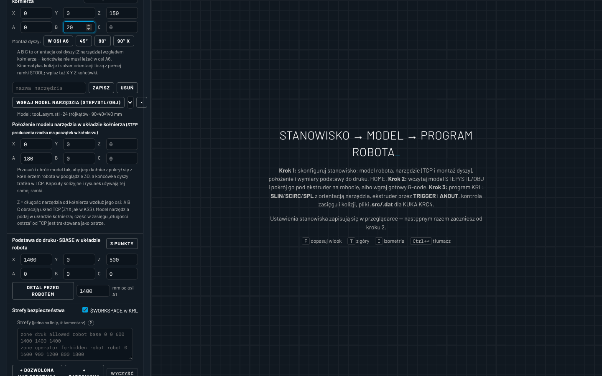

* **STEP/STL/OBJ ekstrudera** wgrywa się w zakładce „Przygotowanie” („wgraj model narzędzia”);
  jednostki i **położenie modelu w układzie kołnierza** (X Y Z A B C, bo pliki
  producenta rzadko mają początek w kołnierzu) ustawia się obok i widać od
  razu w podglądzie 3D na kołnierzu robota. CLI: `--tool-mesh`, `--tool-mesh-frame`.
* Z siatki powstają **kapsuły kolizyjne per spójny element** (korpus obok
  uchwytu nie jest zlewany w jedną grubą kapsułę), przycięte do zasięgu
  elementu wzdłuż osi dyszy, więc półkule kapsuł nie wystają poza korpus;
  ostatnie `cutter_len` mm przy TCP to dysza, która może dotykać materiału.
* **Kolizje z już wydrukowaną częścią** (druk planarny): materiał wypełnia
  otoczkę wypukłą ścieżki (plus margines) do wysokości bieżącej warstwy; każda
  kapsuła uchwytu lub robota poniżej tego poziomu wewnątrz obrysu to kolizja
  (typowo przy pochylonej dyszy, montażu pod kątem, szerokim korpusie).
  Raport: liczba próbek, maksymalne zagłębienie, kapsuły; punkty w 3D, pasek
  robota, ostrzeżenie.
* **Automatyczny obrót narzędzia wokół osi dyszy** przy stałej orientacji
  (ścieżka bez I J K): kandydaci kąta A co 90/45/30/15° są sprawdzane pod
  kątem zasięgu, kolizji z przeszkodami i wydrukiem oraz prześwitu, wybrany A
  trafia do programu (dojazd PTP, `$TOOL` bez zmian). Pozwala odwrócić korpus
  ekstrudera od ściany, stołu czy sąsiednich obiektów.

### HOME na początku i końcu

Program zaczyna się od `PTP XHOME` (zmienna HOME z `$CONFIG.DAT`; opcjonalnie
literalna pozycja osi `PTP {A1 …, A6 …}`) z `BAS (#VEL_PTP, n)` — ten ruch jest
zarazem dojazdem BCO — i kończy się `PTP XHOME` po wyłączeniu ekstrudera, przed
własnymi liniami KRL. Oba ruchy PTP są sprawdzane pod kątem kolizji z
interpolacją w osiach (dokładny midpoint = średnia kątów), wynik jest w pasku
robota („HOME→start OK / koniec→HOME OK”) i w ostrzeżeniach. Opcje w zakładce „Przygotowanie”
GUI i w CLI: `--no-home-start`, `--no-home-end`, `--home-mode axes
--home-axes "0 -90 90 0 0 0"`, `--home-vel 50`.

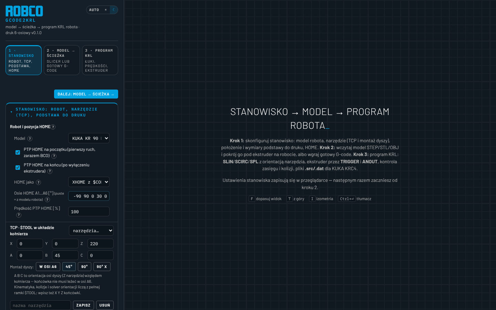

### Orientacja narzędzia: dysza poza osią A6, obrót wokół dyszy, pochylenie

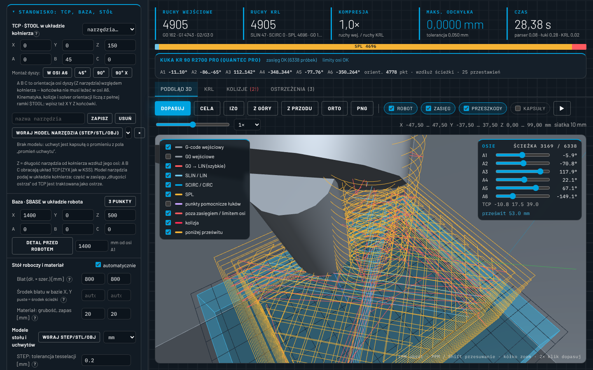

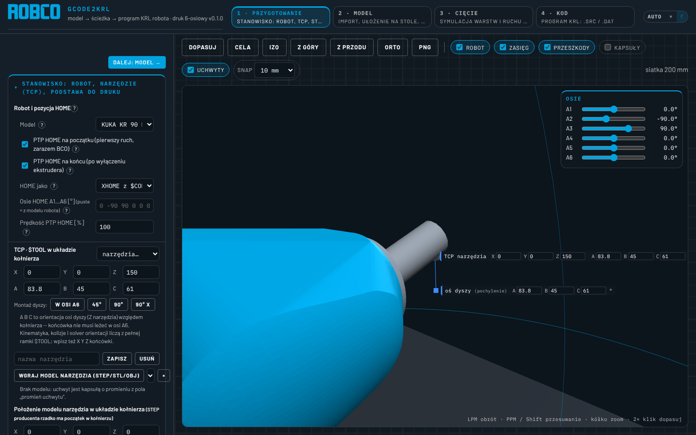

Orientację narzędzia można też ustawić myszą w podglądzie 3D: przy TCP
rysowane są osie narzędzia, uchwyt na końcu osi dyszy (Z narzędzia) pochyla
narzędzie (A B C `$TOOL` liczone z nowego kierunku osi, X narzędzia
zachowane), uchwyt na osi X obraca je wokół dyszy (oś dyszy zostaje
dokładnie, kąt obrotu przyciągany co 5°); etykieta TCP ma pola X Y Z A B C.

* **Montaż dyszy pod kątem.** Ramka `$TOOL` ma pełne A B C: oś dyszy (Z
  narzędzia) nie musi leżeć w osi A6. Presety w sekcji *Stanowisko* („w osi
  A6”, 45°, 90°, 90° X) ustawiają orientację, X Y Z końcówki wpisuje się
  obok. Kinematyka odwrotna, zasięg, limity i solver obrotu liczą z pełnej
  ramki; kapsuły kolizyjne: uchwyt od kołnierza do początku dyszy, dysza
  (ostrze) wzdłuż własnej osi; podgląd 3D rysuje uchwyt i dyszę pod kątem.
* **Obrót wokół osi dyszy** (`--spin-mode`, GUI *Robot*): `free` — solver
  dobiera obrót pod osobliwości i ciągłość osi; `fixed` — stały kąt względem
  orientacji odniesienia (przewody zawsze z tyłu), solver odstępuje tylko
  przy braku zasięgu lub osobliwości; `tangent` — oś X narzędzia podąża za
  kierunkiem ścieżki plus przesunięcie (asymetryczne dysze, podajnik drutu,
  głowica z kablem; 180° = element ciągnięty). Pasek robota pokazuje tryb.
* **Pochylenie dyszy w slicerze** (`tilt_lead`, `tilt_side`): oś dyszy
  pochylona w kierunku ruchu (+ do przodu, − ciągnięta jak palnik WAAM) i w
  bok; także dla warstw płaskich zapisywana jako I J K, a translator
  rozwiązuje obrót. W trybach stożkowych i konforemnych pochylenie dodaje się
  do normalnej warstwy.
* Uwaga: solver obrotu nie zna kolizji — krótkie narzędzie pod kątem 45°
  potrafi zbliżyć nadgarstek do stołu; raport kolizji to pokaże, wtedy
  wydłuż narzędzie, zmień przesunięcie obrotu albo tryb na `free`.

### Druk 6-osiowy: tryby warstw i orientacja narzędzia

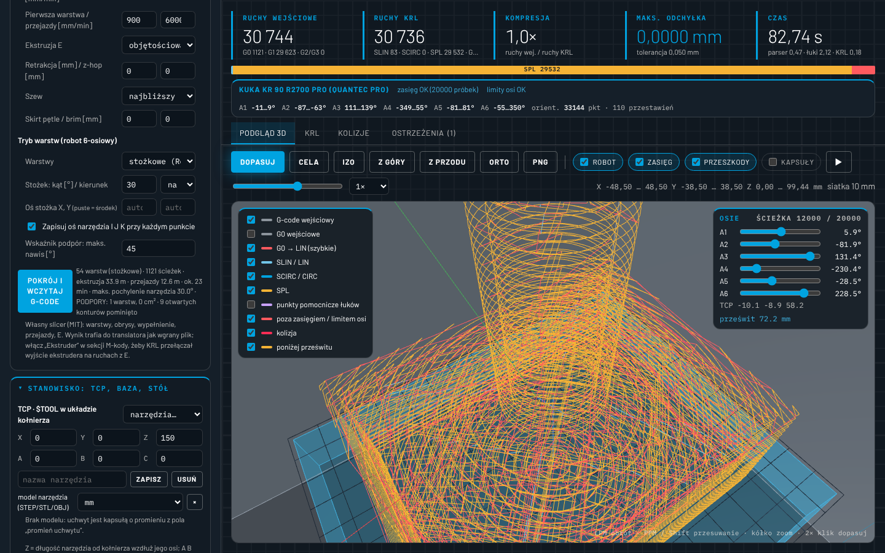

Slicer ma przełącznik *Tryb warstw* (w CLI `--layer-mode`), a cały łańcuch
(parser, translator, KRL, zasięg, kolizje) obsługuje orientację narzędzia
zmienną wzdłuż ścieżki:

| tryb | co robi | literatura |
|---|---|---|
| `planar` | warstwy płaskie, stała orientacja | |
| `conical` | warstwy stożkowe: model deformowany `z' = z ± tan(α)·r`, cięty płasko, ścieżki cofane; dysza pochylona o α na zewnątrz lub do środka, nawisy do 90° bez podpór | Wüthrich, Gubser 2021 (RotBot) |
| `bottom` | warstwy równoległe do powierzchni dolnej (druk na zakrzywionym podłożu, napawanie, naprawa): pole wysokości z siatki, `z' = z − h(x,y)` | Curved Layer FDM: Chakraborty 2008, Singamneni 2012 |
| `top` | warstwy dochodzące do powierzchni górnej bez schodków: `z' = z·H/h(x,y)` | Etienne i in. 2019 (CurviSlicer), Ahlers 2019 |
| `multi` | dekompozycja wielokierunkowa: segmenty ograniczone płaszczyznami, każdy drukowany płasko we własnym kierunku, kolejność z listy | Wu i in. 2017 (RoboFDM), Wu i in. 2019 |

W trybach nieplanarnych każdy punkt G-code dostaje oś narzędzia `I J K`
(wektor od detalu na zewnątrz, normalna warstwy), grubość ścieżki jest
korygowana o `cos(pochylenie)`, a nachylenia pola wysokości są ograniczane do
`max_slope`. Wskaźnik podpór liczy dla każdego trybu powierzchnię warstw
niepodpartą przez warstwę niżej w granicach `overhang_max` (porównanie
płaskie/stożkowe od ręki).

Parser rozumie `A B C` (orientacja KUKA, modalna) i `I J K` na G0/G1 (oś
narzędzia). Translator utrzymuje orientację per punkt (`SPL` z orientacją,
`$ORI_TYPE = #VAR`), łuki są odtwarzane tylko w łańcuchach o stałej
orientacji. Dla osi `I J K` wolny obrót wokół osi narzędzia dobiera
**solver orientacji** (Zhang i in., IEEE RA-L 2021, w wersji uproszczonej):
poprzedni obrót jest utrzymywany, dopóki pozycja jest osiągalna i |A5| jest
powyżej progu; inaczej próbkowane są obroty (i opcjonalnie dodatkowe
pochylenie w stożku) i wybierany jest najtańszy w sensie ruchu osi. Zasięg i
kolizje są liczone z orientacją per próbkę (interpolowaną wzdłuż SPL).

Ekstruder: oprócz wyjścia cyfrowego jest tryb analogowy proporcjonalny do
prędkości toru, `ANOUT ON $ANOUT[n] = k · $VEL_ACT` z `$VEL_FLT_OFF = TRUE`
(przykład dozowania z dokumentacji KRL); współczynnik `k` liczony jest z
E/mm segmentów slicera i wydajności ekstrudera przy sygnale 1,0, a przy
zmianie E/mm (np. inna wysokość warstwy) wyjście jest przeprogramowywane.

```bash
gcode2krl-slice czesc.step -o czesc.gcode --layer-mode conical --cone-angle 30
gcode2krl-slice czesc.step -o czesc.gcode --segments segmenty.txt      # tryb multi
gcode2krl czesc.gcode -o out/ --robot KR90R2700PRO --base-frame 1400 0 500 0 0 0 --tool-frame 0 0 150 0 0 0 \
    --extruder-anout 2 --extruder-flow-full 50 --spin-step 15 --singular-deg 8
```

Nie ma (jeszcze): optymalizacji pola skalarnego warstw (Dai 2018, S3-Slicer
2022, Neural Slicer 2024), automatycznej dekompozycji, osi zewnętrznych,
kolizji z już wydrukowanym materiałem (dodaj segmenty jako przeszkody
ręcznie).

W GUI sekcja *Slicer* kroi wgrany model i od razu wczytuje G-code do
translatora. Translator rozumie E (M82/M83, G92 E0) i z opcją *Ekstruder*
wstawia `$OUT[n] = TRUE/FALSE` wokół ruchów z ekstruzją, dzięki czemu KRL
steruje ekstruderem na robocie. Łuki, zasięg i kolizje działają na wyniku
slicera tak samo jak na G-code z CAM.

## Model robota (KR 90 R2700 pro i inne)

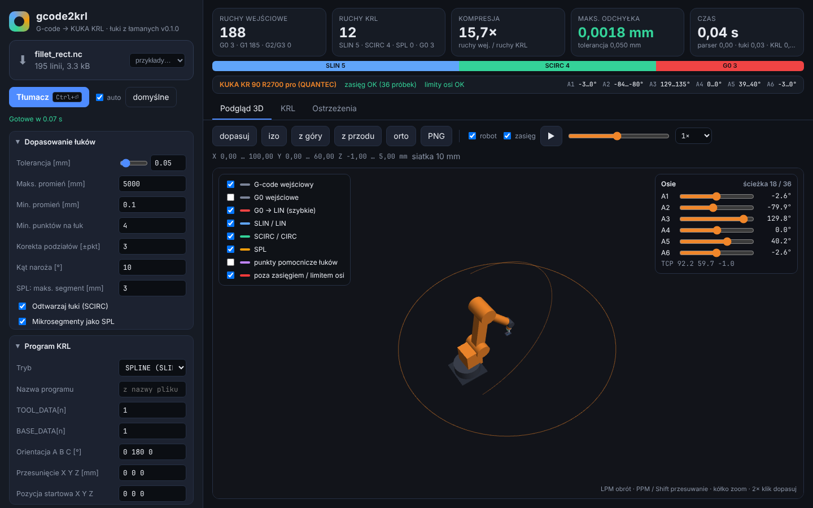

Definicje robotów leżą w `gcode2krl/robots/<KLUCZ>.json` (plus `~/.gcode2krl/robots/`
dla własnych) razem z siatkami STL w `robots/meshes/`. Każdy plik ma pole
`sources` z pochodzeniem każdej grupy danych, pokazywane też w GUI w panelu *Robot*.

| klucz | model | geometria i siatki | dane osi |
|---|---|---|---|
| `KR90R2700PRO` (domyślny) | KR 90 R2700 pro (QUANTEC pro) | URDF KR 120 R2500 pro z ROS-Industrial (konwersja z CAD KUKA: 675 / 350 / 1150 / −41 / 215 mm), przedramię 1000 → 1200 mm zgodnie z zasięgiem 2696 mm; siatka przedramienia wydłużona o 200 mm | karta katalogowa KUKA KR 90 R2700 pro: A1 ±185° 136°/s, A2 −140/−5° 130°/s, A3 −120/+155° 120°/s, A4 ±350° 292°/s, A5 ±125° 258°/s, A6 ±350° 284°/s; 90 kg, 2696 mm, ±0,06 mm |
| `KR120R2500PRO` | KR 120 R2500 pro (QUANTEC pro) | URDF + STL ROS-Industrial | karta KR QUANTEC pro (limity/prędkości w URDF były skopiowane z KR 16-2 i zostały zastąpione) |
| `KR150R3100_2` | KR 150 R3100-2 (QUANTEC-2) | URDF + STL ROS-Industrial | URDF ROS-Industrial |
| `KR16_2` | KR 16-2 | URDF + STL ROS-Industrial | URDF, zgodny z kartą KR 16-2 (A2 +35/−155°, A3 +154/−130°, 156/156/156/330/330/615 °/s) |
| `KR6R900SIXX`, `KR6R700SIXX`, `KR10R1100SIXX`, `KR3R540` | KR AGILUS sixx | URDF + STL ROS-Industrial | URDF, zgodny z kartą KR AGILUS (np. KR 6 R900: ±170°, −190/+45°, −120/+156°, ±185°, ±120°, ±350°; 360/300/360/381/388/615 °/s) |
| `KR10R1420` | KR 10 R1420 | URDF + STL ROS-Industrial | URDF ROS-Industrial |

Siatki i origins stawów pochodzą z pakietów
[ROS-Industrial `kuka_experimental`](https://github.com/ros-industrial/kuka_experimental)
(Apache-2.0, pliki konwertowane z danych CAD KUKA; licencja i pochodzenie w
`gcode2krl/robots/NOTICE.md`). Konwencje osi w tych URDF są dokładnie
konwencjami KSS: A1 obraca wokół −Z, A4 i A6 wokół −X, `tool0` to kołnierz
obrócony o 90° wokół Y, więc HOME (A1 0, A2 −90, A3 90, A4 0, A5 0, A6 0)
daje dla KR 90 kołnierz w X 1765, Z 1784, B 90, jak na rzeczywistym KR QUANTEC.
Dane osi z URDF są oznaczone jako takie i należy je sprawdzić z kartą
katalogową własnej wersji robota (w sesji, w której to pisano, strony KUKA były
niedostępne; wartości dla KR 90 R2700 pro pochodzą z kilku zgodnych kopii karty
katalogowej KUKA).

**Własne dane z CAD KUKA.** Importer wczytuje URDF/xacro ze standardowym
łańcuchem KUKA i siatki STL (np. wyeksportowane z modeli STEP z KUKA Download
Center albo z KUKA.Sim) i buduje definicję z kapsułami kolizyjnymi:

```bash
gcode2krl-import --xacro kr90r2700pro_macro.xacro --key KR90R2700PRO --out ~/.gcode2krl/robots
gcode2krl-import --kuka-experimental /sciezka/do/kuka_experimental --out ~/.gcode2krl/robots
```

Bryły kolizyjne są liczone z siatek automatycznie: podstawa (nieruchoma)
dostaje obrócony prostopadłościan, każdy ruchomy człon zestaw kapsuł
(trójkąty dzielone do 16 mm, klastrowanie k-means, kapsuła na klaster z zapasem
połowy krawędzi, więc **cała powierzchnia siatki jest objęta**; test
`test_mesh_capsules_enclose_meshes` to sprawdza). Pary członów, które z
konstrukcji zawsze się stykają (np. obudowa A5 w końcówce przedramienia), są
zapisane w `disabled_pairs` i pomijane w autokolizjach.

Kinematyka: kinematyka prosta w konwencjach KSS i odwrotna w postaci
zamkniętej (8 rozwiązań: bark przód/tył, łokieć góra/dół, nadgarstek z
przewrotem i bez), wybór rozwiązania w limitach osi i najbliższego poprzedniej
pozie, sprawdzenie całej ścieżki. Testy obiegu FK → IK → FK przechodzą dla
wszystkich dziewięciu modeli.

**Stanowisko w GUI (sekcja *Stanowisko: TCP, baza, stół*).** TCP i bazę
ustawia się polami X Y Z A B C: TCP w układzie kołnierza (Z to długość
narzędzia), baza w układzie robota. Narzędzia można zapisywać jako presety
(wraz z promieniem uchwytu i ostrza), bazę wyznaczyć **metodą 3-punktową jak
w KSS** (początek, punkt na +X, punkt w płaszczyźnie XY, w układzie robota)
albo przyciskiem *detal przed robotem* (przesuwa bazę tak, by środek ścieżki
był w zadanej odległości od osi A1). Stół i materiał są generowane
automatycznie z bazy: prostopadłościan materiału pod obrysem ścieżki z górną
powierzchnią w Z = 0 bazy (ostrze może w niego wchodzić) i blat pod
materiałem sięgający do posadzki, jako wpisy `# auto` w przeszkodach; można je wyłączyć i
pisać ręcznie. Układ bazy i TCP są rysowane w podglądzie 3D. W CLI:
`--base-points OX OY OZ XX XY XZ PX PY PZ` liczy bazę z trzech punktów.

**Własne modele stołu, uchwytów i narzędzia (STL/OBJ).** Przycisk *dodaj
STL/OBJ* w sekcji *Stół roboczy* wgrywa plik do lokalnego magazynu
(`~/.gcode2krl/meshes`, zmienna `GCODE2KRL_MESH_DIR`) i dodaje go do
przeszkód jako wiersz `mesh NAZWA base X Y Z A B C ID jednostki [workpiece]`;
położenie edytuje się polami przy modelu lub w tekście przeszkód, a flaga
„materiał” zwalnia ostrze z kolizji z tym modelem. *Model narzędzia* wgrywa
siatkę w układzie kołnierza (mm, cm, m lub cale) i zastępuje parametryczną
kapsułę uchwytu; część w zasięgu „długości ostrza” od TCP jest traktowana
jako ostrze. Bryły kolizyjne są liczone z siatki (pudełko albo zestaw kapsuł,
zawsze z zapasem) i buforowane; siatki są rysowane w podglądzie, a przycisk
*kapsuły* pokazuje, co dokładnie jest sprawdzane. W CLI: `--tool-mesh
plik.step --tool-mesh-units mm` oraz wiersze `mesh` w pliku `--obstacles` ze
ścieżką do pliku zamiast ID.

**STEP i IGES.** Pliki `.step/.stp/.iges/.igs` (np. z KUKA Download Center
albo z własnego CAD) są wczytywane bezpośrednio i tesselowane kernelem
OpenCASCADE z zadaną tolerancją (pole *STEP: tolerancja tesselacji*, domyślnie
0,2 mm); jednostki są brane z pliku (mm, cale itd.), a siatka jest buforowana
jako STL w magazynie. Potrzebny jest jeden z kerneli:

```bash
pip install -e .[step]          # cadquery-ocp (OpenCASCADE), koła pip dla Windows, Linux, macOS
pip install gmsh                # alternatywa (na Linuksie wymaga libglu1-mesa)
```

Bez kernela GUI pokazuje komunikat, a STL/OBJ działają nadal.

Co robi sprawdzenie (`--robot`, w GUI panel *Robot*):

* `$BASE` podajesz w układzie robota (X Y Z A B C), `$TOOL` w układzie
  kołnierza; orientacja narzędzia na ścieżce to `--abc`. Do programu trafiają
  **deklaracje** obu układów (domyślnie, `--frame-mode declare`, w GUI „TCP i
  baza w programie”): `TOOL_DATA[n] = {X …, Y …, Z …, A …, B …, C …}` i
  `BASE_DATA[n] = {…}` przed `$TOOL = TOOL_DATA[n]` / `$BASE = BASE_DATA[n]`,
  więc program niesie wartości, a sterownik ma je w `$CONFIG.DAT`; `data`
  zostawia samo wywołanie `TOOL_DATA[n]` (wartości ze sterownika), `literal`
  wpisuje `$TOOL = {…}` / `$BASE = {…}` wprost.
* Dla próbek wzdłuż wygenerowanej ścieżki liczona jest kinematyka odwrotna.
  Raport: liczba próbek poza zasięgiem, poza limitami osi (z podziałem na
  osie) oraz zakres min/max każdej osi. CLI zwraca kod wyjścia 3, gdy coś
  jest poza zasięgiem.
* W GUI robot jest rysowany z siatek STL (gdy definicja je ma) albo z brył
  zastępczych, z kołnierzem, narzędziem, układem TCP i obwiednią zasięgu.
  Przycisk ▶ albo spacja animuje przejazd po ścieżce, suwak przewija próbki,
  panel *Osie* pokazuje kąty (na czerwono poza limitem) i pozwala ustawić
  robota ręcznie suwakami. Przycisk *cela* (`C`) dopasowuje widok do robota.

```bash
gcode2krl sciezka.nc -o out/ --robot KR90R2700PRO --base-frame 1200 0 500 0 0 0 --tool-frame 0 0 150 0 0 0
gcode2krl x.nc --robot list
```

### Kolizje

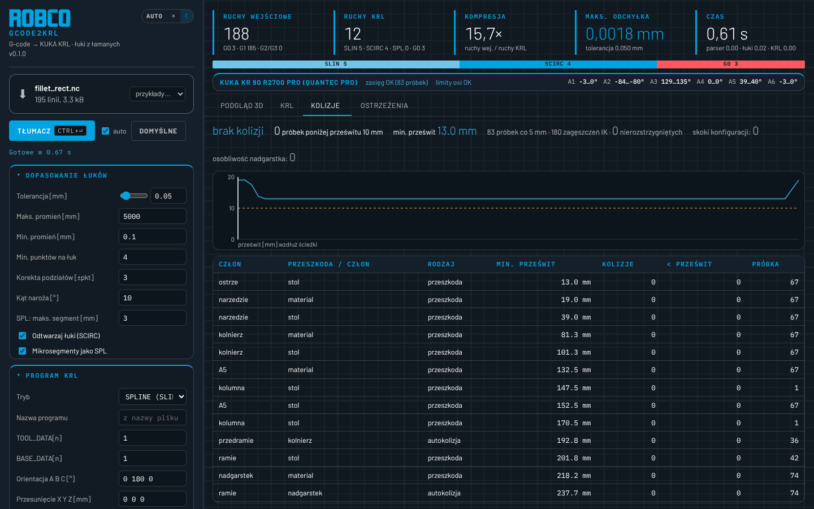

Sprawdzanie kolizji (`gcode2krl/collision.py`) jest liczone dla całej ścieżki
i ma być wiarygodne, dlatego:

* **Geometria dokładna, nie próbkowana.** Członki robota to kapsuły
  (odcinek + promień) obejmujące siatki STL z CAD, podstawa to obrócony
  prostopadłościan, narzędzie to kapsuły uchwytu i ostrza.
  Przeszkody to bryły wypukłe: pudełka (także obrócone), pionowe walce, kule i
  podłoga. Odległość kapsuła–kapsuła to dokładna odległość odcinek–odcinek,
  a kapsuła–przeszkoda to minimum wypukłej funkcji odległości wzdłuż odcinka
  (złoty podział, zbieżność do 1e-6 mm). Wszystko jest zwektoryzowane w numpy
  dla wszystkich próbek naraz.
* **Ostrze a materiał.** Przeszkoda oznaczona `workpiece` jest ignorowana
  tylko dla kapsuły ostrza (ostatnie `--cutter-len` mm narzędzia). Uchwyt,
  obudowa A6 i reszta robota muszą od materiału trzymać prześwit, więc za
  głębokie wejście albo za krótkie narzędzie wychodzi jako kolizja.
* **Autokolizje.** Pary członków nieprzylegających (przedramię, nadgarstek,
  A6, narzędzie i ostrze przeciw podstawie, kolumnie, ramieniu; narzędzie
  przeciw przedramieniu).
* **Ciągłość między próbkami.** Ścieżka jest próbkowana co `--path-step`
  (domyślnie 5 mm, wszystkie wierzchołki, łuki i G0 włącznie). Między
  sąsiednimi próbkami żaden punkt członu nie przemieszcza się dalej niż jego
  końce kapsuły (plus zapas na obrót), więc przedział jest *udowodniony* jako
  wolny, gdy `max(c_i, c_i+1) − δ_i ≥ prześwit`. Przedziały, których nie da się
  udowodnić, są dzielone na pół (IK w punkcie środkowym) do 6 razy; to, co
  nadal nie jest rozstrzygnięte, jest raportowane jako *nierozstrzygnięte*,
  nigdy nie jest po cichu uznane za bezpieczne. Test z cienką ścianką między
  dwiema próbkami odległymi o 200 mm pokazuje, że zagęszczanie ją znajduje.
* **Skoki konfiguracji i osobliwości.** Zmiana o ponad 30° na A1–A3 między
  sąsiednimi próbkami (łokieć/bark przeskoczył do innego rozwiązania, czego
  sterownik w bloku SPLINE nie wykona) i próbki z |A5| < 5° (osobliwość
  nadgarstka) są liczone i wypisywane w notatkach.
* **Raport.** Liczba próbek w kolizji i poniżej wymaganego prześwitu
  (`--margin`, domyślnie 10 mm), minimalny prześwit, tabela par (człon,
  przeszkoda, min. prześwit, próbka), wykres prześwitu wzdłuż ścieżki, punkty
  kolizji na czerwono w podglądzie, prześwit przy bieżącej pozie w panelu
  osi. CLI zwraca kod 3 przy kolizji lub nierozstrzygniętych przedziałach.

Przeszkody podaje się tekstem, jedna na linię, w układzie robota (`robot`)
albo obrabianego detalu (`base`):

```
floor posadzka robot 0
box stol robot 1300 0 240 900 900 480           # środek x y z, wymiary sx sy sz [a b c]
box material base 50 30 -10 140 100 20 workpiece
cylinder slupek base 150 30 60 15 120            # środek, promień, wysokość
sphere kamera robot 800 -600 1500 120
```

```bash
gcode2krl sciezka.nc -o out/ --robot KR90R2700PRO --base-frame 1200 0 500 0 0 0 \
    --tool-frame 0 0 150 0 0 0 --obstacles cela.txt --margin 10 --path-step 5
gcode2krl x.nc --obstacles help     # opis formatu
```

Czego model **nie** obejmuje: kolizji z kablami i osprzętem na ramieniu
(pakiety energetyczne nie są w siatkach), ruchów PTP (sprawdzane są tylko
ruchy po ścieżce) i dynamiki. Kapsuły obejmują siatki z zapasem, więc wynik
jest po stronie bezpiecznej. Przy własnym narzędziu ustaw `--tool-radius`,
`--cutter-len`, `--cutter-radius`; przy własnym robocie użyj
`gcode2krl-import`.

Dodanie własnego modelu: nowy wpis `RobotModel(...)` w `gcode2krl/robot.py`
(wymiary, limity, prędkości, podpowiedzi wizualne) pojawia się automatycznie
w CLI i w GUI.

## Wydajność

Dopasowanie okręgu jest liczone bez SVD (szybka ścieżka dla ścieżek płaskich,
rozkład własny macierzy 3×3 dla przestrzennych), rozszerzanie łuku używa
wyszukiwania podwajającego zamiast liniowego, a długie łańcuchy są cięte w
ostrych narożach (>60°, łuk i tak przez nie nie przejdzie) i liczone
równolegle w puli procesów. Skan powierzchni 3D z 60 000 wierzchołków:
3,8 s na 4 rdzeniach (kompresja 33×). Podgląd WebGL rysuje setki tysięcy
segmentów bez zacięć, bo renderuje tylko przy zmianie widoku.

## Użycie

```bash
gcode2krl sciezka.nc -o out/                      # bloki SPLINE (zalecane na KRC4)
gcode2krl sciezka.nc -o out/ --mode lin           # klasyczne LIN / CIRC z C_DIS
gcode2krl sciezka.nc -o out/ --tol 0.02 --abc 0 180 0 --tool 2 --base 3 --spindle-out 5
python -m gcode2krl.cli --help                    # pełna lista opcji
```

Przykładowy wynik dla `examples/fillet_rect.nc` (prostokąt z czterema
zaokrągleniami R10 zapisany jako 185 ruchów G1):

```
input : 188 moves (G0=3 G1=185 G2=0 G3=0), 194 lines
output: 12 motions (lines=5 arcs=4 spl points=0 in 0 runs, rapids=3)
compression 15.7x, max deviation 0.0018 mm (tolerance 0.05)
```

```
SPLINE WITH $VEL.CP = 0.0200, $ACC.CP = 2.00
  SLIN {X 90.000, Y 0.000, Z -1.000, A 0.000, B 180.000, C 0.000}
  SCIRC {X 97.071, Y 2.929, Z -1.000, A 0.000, B 180.000, C 0.000}, {X 100.000, Y 10.000, Z -1.000, A 0.000, B 180.000, C 0.000}
  SLIN {X 100.000, Y 50.000, Z -1.000, A 0.000, B 180.000, C 0.000}
  ...
ENDSPLINE C_SPL
```

## Jak działa dopasowanie łuków (`gcode2krl/arc_fitter.py`, `geometry.py`)

Łańcuch kolejnych ruchów G1 (ten sam posuw, bez przerw) jest dzielony na
odcinki proste i łuki tak, aby **cała ścieżka wyjściowa leżała w paśmie
tolerancji `--tol` wokół oryginalnej łamanej**, a liczba elementów była jak
najmniejsza. Kroki:

1. **Zachłanne rozszerzanie.** Od bieżącego wierzchołka rozszerzany jest
   niezależnie odcinek (dopóki wszystkie wierzchołki leżą w tolerancji od
   cięciwy) i łuk. Łuk jest po każdym dołożonym wierzchołku dopasowywany od
   nowa, więc błąd środka wyznaczonego z pierwszych trzech punktów nie tnie
   długiego łuku na kawałki. Łuk wygrywa, jeśli obejmuje więcej wierzchołków
   niż odcinek i ma ich co najmniej `--min-arc-points`.
2. **Dopasowanie okręgu.** Start algebraiczny metodą Taubina (Chernov), potem
   geometryczne dopasowanie najmniejszych kwadratów ze **środkiem na
   symetralnej cięciwy końcowej** (Gribov). Dzięki temu łuk przechodzi
   dokładnie przez pierwszy i ostatni wierzchołek, co jest wymagane przez
   `CIRC`/`SCIRC` (punkt startowy, pomocniczy i końcowy leżą na jednym okręgu).
   Okręgi są dopasowywane w 3D: najpierw płaszczyzna (SVD), potem okrąg w niej,
   więc łuki w dowolnej płaszczyźnie są obsługiwane.
3. **Walidacja łuku:** wierzchołki w tolerancji od płaszczyzny i okręgu,
   każda cięciwa w tolerancji od okręgu (dokładnie: `R - dist(środek, cięciwa)`,
   nie tylko strzałka), kąt rosnący monotonicznie (brak nawrotów), promień
   w `[--min-radius, --max-radius]`, kąt rozwarcia ≤ 360°. Limit promienia
   chroni przed zamianą prawie prostych odcinków na gigantyczne łuki.
4. **Korekta punktów podziału.** Dla każdej pary sąsiednich elementów wspólny
   punkt podziału jest przesuwany o ±`--refine-shift` wierzchołków i wybierany
   jest wariant z najmniejszym błędem. Naprawia to "kradzione" punkty na
   stycznych połączeniach odcinek/łuk i łuk/łuk o różnych promieniach.
5. **Scalanie.** Sąsiednie łuki, które da się opisać jednym okręgiem w
   tolerancji, są łączone, więc jeden duży łuk nigdy nie wychodzi jako ciąg
   małych.
6. **Pełne okręgi** (łańcuch zamknięty) są dzielone na dwa `SCIRC` po 180°.
7. **Punkty SPL.** Ciągi krótkich (≤ `--spl-max-segment`) dwuwierzchołkowych
   odcinków, których nie dało się złożyć w łuk ani w dłuższy odcinek
   (zmienna krzywizna: spirale, klotoidy, zaszumione skany), są przerzedzane
   algorytmem Douglasa-Peuckera z tolerancją `--tol` i zapisywane jako `SPL`.
   Sterownik KRC prowadzi przez nie własny splajn. `--no-spl` wyłącza to.

Wynik `max deviation` w raporcie to największe odchylenie wyjścia od
oryginalnej łamanej liczone wewnętrznie; funkcja `arc_fitter.max_deviation`
liczy je niezależnie (Hausdorff przez próbkowanie) i jest używana w testach.

## Mapowanie na KRL (`gcode2krl/krl_writer.py`)

| G-code | KRL (`--mode spline`) | KRL (`--mode lin`) |
|---|---|---|
| G0 | `LIN ... ` z `$VEL.CP = --rapid-vel` (C_DIS między kolejnymi G0) | tak samo |
| G1 (odcinek) | `SLIN {X,Y,Z,A,B,C}` w bloku `SPLINE` | `LIN ... C_DIS` |
| G1 (rozpoznany łuk), G2/G3 | `SCIRC {pkt pomocniczy}, {koniec}` | `CIRC ..., ... C_DIS` |
| G1 (mikrosegmenty, zmienna krzywizna) | `SPL {...}` | `LIN ... C_DIS` |
| G2/G3 helikalne | linearyzacja (`tol/2`), dalej jak G1 | jak G1 |
| F | `SPLINE WITH $VEL.CP = F/60000` (m/s) | `$VEL.CP = ...` |
| G4 P | `WAIT SEC` | |
| M3/M4/M5 | komentarz, `$OUT[--spindle-out]`, `$ANOUT[--spindle-anout]` | |
| M7/M8/M9 | komentarz, `$OUT[--coolant-out]` | |
| M6 | komentarz + `HALT` (`--no-halt-tool-change` wyłącza) | |
| M0/M1 | `HALT` | |
| M2/M30 | koniec programu | |

Zasady bloków `SPLINE`:

* blok jest planowany przez KRC jako jeden ruch, więc nie ma spadków prędkości
  między mikro-odcinkami, które występują przy tysiącach `LIN` (krótkie
  wyprzedzenie `$ADVANCE`);
* blok kończy się przy zmianie posuwu, w narożu (kąt skrętu >
  `--corner-angle`, domyślnie 10°) i po `--max-block-segments` segmentach;
* wewnątrz bloku KSS zatrzymuje robota („Velocity 0 m/s in point …
  (SLIN-SCIRC sequence)” / „(broken XYZ path)” w RRS) w każdym złączu dwóch
  segmentów `SLIN`/`SCIRC`, które nie są styczne — niezależne dopasowanie
  odcinków i łuków zostawia w złączach załamania rzędu 0,1–5°. Writer pilnuje
  styczności: złącze z załamaniem większym niż `--tangent-deg` (0,1°) dostaje
  **mostek SPL** — odcinek kończy się `--bridge-mm` (≤ 3 mm, skracane tak, by
  odchyłka została w setnych mm) przed złączem, punkt `SPL` leży w złączu, a
  łuk po załamaniu idzie punktami `SPL`; krótkie odcinki stają się jednym
  punktem `SPL`. Punkty powtórzone (zerowe odcinki) są pomijane;
* `ENDSPLINE C_SPL` wygładza przejście do następnego ruchu CP (`SPLINE`,
  `LIN`); przed `PTP`, wyjściem `$OUT`, `WAIT`, `HALT`, `BAS`, wywołaniem
  podprogramu i `END` blok kończy się zwykłym `ENDSPLINE`, bo KSS zgłasza tam
  „Approximation inadmissible” (`--no-block-approx` dla starszych wersji KSS,
  które nie znają `C_SPL`);
* wygenerowane pliki przechodzą lint pod te reguły (`python -m
  gcode2krl.krl_lint PLIK.src`, w GUI i CLI jako ostrzeżenia „KSS …”);
* w trybie `lin` naroża są domyślnie dokładne (bez `C_DIS`), `--round-corners`
  zaokrągla wszystko odległością `$APO.CDIS = --cdis`.

Pozycje są zapisywane jako `FRAME` ze stałą orientacją `--abc` (domyślnie
`A 0 B 180 C 0`, czyli oś Z narzędzia skierowana w dół w układzie BASE).
Układ współrzędnych G-code jest utożsamiany z `BASE_DATA[--base]`; dodatkowo
można dodać przesunięcie `--offset`. Narzędzie to `TOOL_DATA[--tool]`.

Programy dłuższe niż `--max-motions-per-file` ruchów są dzielone na
podprogramy `NAZWA_001.src`, `NAZWA_002.src`, ... wywoływane z `NAZWA.src`
(bloki `SPLINE` nigdy nie są przecinane). Pliki mają końce linii CRLF.

## Parser G-code (`gcode2krl/gcode_parser.py`)

Obsługuje: G0/G1/G2/G3 (modalne), łuki przez I/J/K i R (R ujemne = łuk >
180°), pełne okręgi (`G2 I-10`), helisy, G17/G18/G19, G20/G21, G90/G91,
G90.1/G91.1, G4, G94 (G93 ostrzeżenie), M0/M1/M2/M30/M3/M4/M5/M6/M7/M8/M9,
słowa F/S/T, komentarze `( )` i `;`, numery bloków N, `%`, `O1234`.
Pomijane z ostrzeżeniem: G28/G30, G92, G53, G54–G59 (współrzędne przechodzą
bez zmian), G41/G42 (kompensacja nie jest liczona), cykle G81–G89, splajny
G5.x. Niezgodność promienia początku i końca łuku jest korygowana przez
przesunięcie środka na symetralną cięciwy (z ostrzeżeniem powyżej 0,002 mm).

## Tolerancje i dokładność robota

Dokładność toru robota KUKA to dziesiąte części milimetra, więc domyślna
tolerancja 0,05 mm jest bezpieczna i daje mało fragmentacji. Przy
tolerancjach rzędu zaokrąglenia współrzędnych (0,001 mm) łuki będą się ciąć
na kawałki, bo CAM zapisuje wierzchołki z błędem do ±0,0007 mm.

## Ograniczenia

* Orientacja narzędzia jest stała (3-osiowy G-code). Brak obsługi osi A/B/C
  z G-code i kinematyk zewnętrznych (E1–E6).
* Model robota: siatki z ROS-Industrial (konwersja z CAD KUKA), kapsuły
  z zapasem zamiast dokładnych obudów, brak osprzętu na ramieniu; dane osi z
  URDF do sprawdzenia z kartą katalogową; nie zastępuje testu na sterowniku.
* `PTP $POS_ACT` jako ruch BCO na początku (`--no-bco` wyłącza); wejście na
  ścieżkę z pozycji HOME trzeba dopisać w programie nadrzędnym.
* Limit liczby punktów w bloku `SPLINE` zależy od wersji KSS; domyślne 500
  segmentów na blok jest ostrożne, sprawdź dokumentację swojej wersji.
* Składnia `SCIRC ... , CA kąt` nie jest używana; pełne okręgi są dzielone
  na dwa łuki.
* G93 (posuw odwrotny do czasu) i kompensacja promienia narzędzia nie są
  realizowane.

## Literatura

* Gribov, *Optimal Compression of a Polyline with Segments and Arcs* (2016)
  oraz *Approximate Fitting of a Circular Arc When Two Points Are Known* (2015)
* Al-Sharadqah, Chernov, *Error analysis for circle fitting algorithms*, EJS 2009
* Drysdale, Rote, Sturm, *Approximation of an open polygonal curve with a
  minimum number of circular arcs and biarcs*, CGTA 2008
* Horng, Li, *A dynamic programming approach for fitting digital planar curves
  with line segments and circular arcs*, PRL 2001
* Rosin, West, *Segmentation of edges into lines and arcs*, IVC 1989
* KUKA, *KSS 8.x Operating and Programming Instructions for System
  Integrators* (bloki SPLINE, SLIN, SCIRC, SPL, C_SPL)

## Struktura

```
gcode2krl/
  gcode_parser.py   parser modalny G-code -> ruchy i zdarzenia
  geometry.py       płaszczyzny, Taubin, dopasowanie z ustalonymi końcami, walidacja łuku 3D
  arc_fitter.py     segmentacja łamanej: odcinki + łuki, korekta podziałów, scalanie, pula procesów
  simplify.py       Douglas-Peucker (przerzedzanie punktów SPL)
  translator.py     łańcuchy G1 -> elementy ruchu, helisy, pełne okręgi, grupowanie SPL
  krl_writer.py     generowanie .src/.dat, bloki SPLINE, LIN/CIRC, podział na podprogramy
  robot.py          model KUKA z JSON (origins z URDF), kinematyka prosta/odwrotna, zasięg i limity
  robot_import.py   importer URDF/xacro + STL -> definicja JSON, kapsuły i OBB z siatek (gcode2krl-import)
  meshio.py         czytanie/zapis STL
  collision.py      kapsuły, przeszkody, dokładne odległości, sprawdzanie ciągłe, raport kolizji
  robots/           definicje robotów (JSON ze źródłami), siatki STL, LICENSE i NOTICE (Apache-2.0)
  cli.py            interfejs wiersza poleceń (gcode2krl)
  slicer/           slicer MIT: mesh_slice (kontury), adaptive (warstwy adaptacyjne), toolpath (ściany, gap fill, skin,
                    wypełnienie, raft, kolejność), infill (wzory), features (nawisy, mosty), support (podpory),
                    deform (tryby stożkowe/konforemne), decompose (segmenty), gcode_writer, cli (gcode2krl-slice)
  stepio.py         tesselacja STEP/IGES (OpenCASCADE przez OCP lub gmsh)
  meshstore.py      magazyn wgranych modeli (STL/OBJ/STEP)
  server.py         lokalny serwer HTTP + API JSON (gcode2krl-gui)
  web/              GUI: index.html, app.js, slicer_form.js (formularz slicera ze schematu), help.js (pomoc „?”),
                    viewer.js (WebGL), robot.js (model robota), style.css, brand.css
examples/           fillet_rect.nc, circle_g1.nc, mixed.nc
tests/              pytest (rdzeń, parser, writer, CLI, serwer)
.github/workflows/  CI: pytest na Ubuntu i Windows, Python 3.10 i 3.12
```
